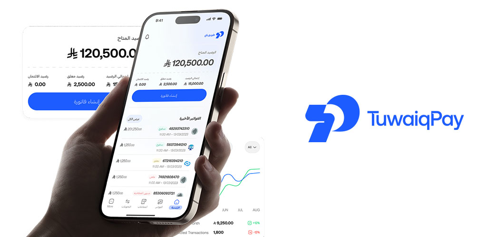
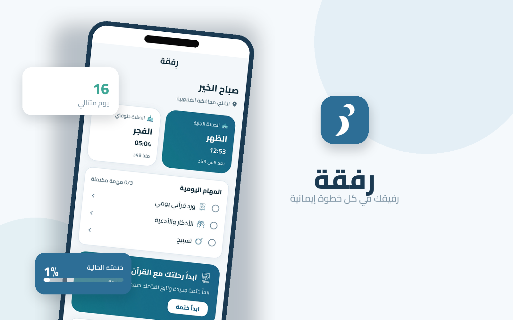
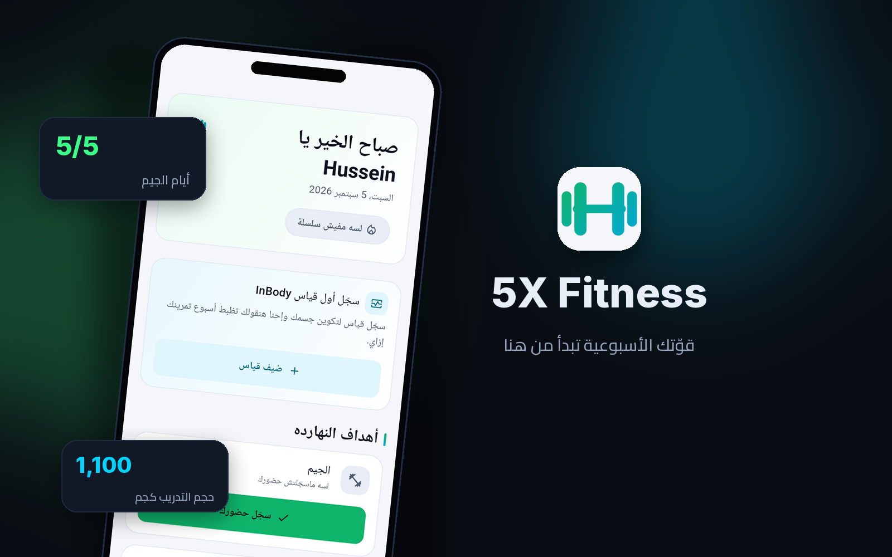
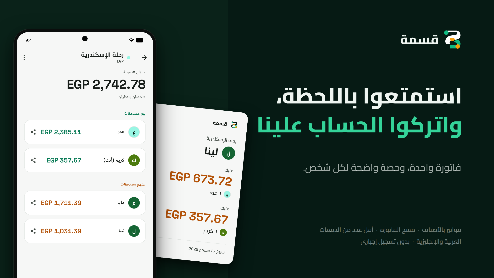
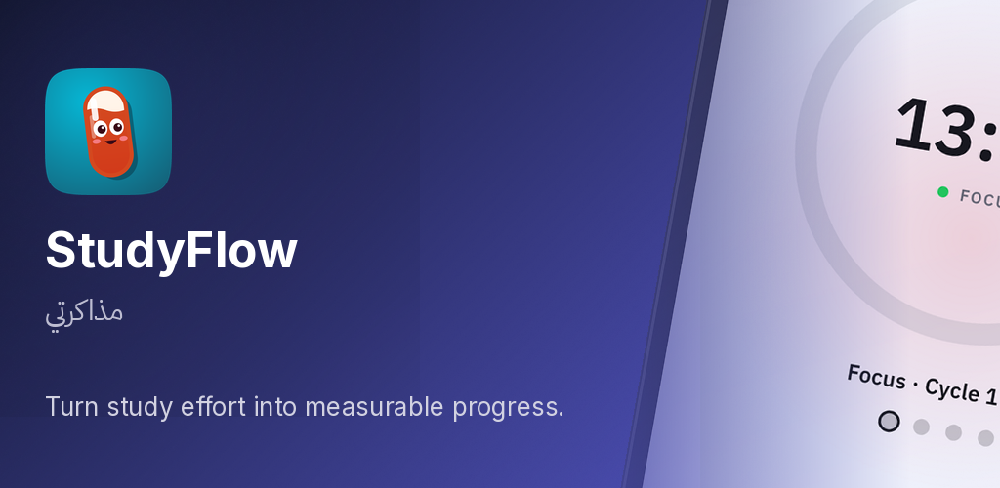
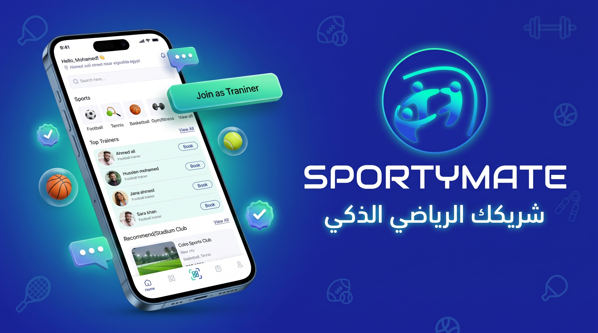

<h1 align="center">

</h1>

  

------------------------------------------------------------------------

## 👨‍💻 About Me

I'm a Flutter Developer with 3+ years of experience building and shipping
cross-platform iOS and Android applications. I work across the product
lifecycle: architecture, API integration, testing, release automation,
and store deployment.

My experience spans fintech, fitness, sports-tech, Islamic applications,
education/productivity tools, and an Arabic-first cultural platform, with a
focus on maintainable architecture, reliable integrations, and polished
Arabic/English experiences.

-   📱 Built and shipped mobile applications for real-world use.
-   🏗️ Experienced with Clean Architecture, feature-based structure,
    Riverpod, BLoC, and MVVM.
-   🔌 Integrated REST APIs, Firebase, Supabase, and payment solutions
    including NearPay, Paymob, Stripe, and PayPal.
-   🚀 Worked with GitHub Actions, Fastlane, Firebase App Distribution,
    and TestFlight.
-   🌍 Built bilingual applications with Arabic and English
    localization and full RTL support.

## 💼 Experience

### Hayah Documentary · Mobile Developer
*Cairo, Egypt · Oct 2026 – Present*

-   Responsible for the mobile application development workstream across iOS and Android.
-   Developing **Hayahbook**, a bilingual, Arabic-first cultural reading and audio platform.
-   Building experiences for digital reading, audio content, social interactions, and cultural communities.
-   Integrating REST APIs with Dio and working with Supabase and Firebase services.

### Tuwaiq Pay · Flutter Developer
*Remote · Sep 2025 – Sep 2026*

-   Built and maintained a production fintech app (iOS and Android) used by merchants for invoicing, payments, and transaction management.
-   Delivered features with Flutter, Riverpod, and Clean Architecture, including sub-account support and differentiated UI/API behavior.
-   Led key modules: authentication, biometric login, NearPay SDK integration, localized NFC error handling, and Arabic/English localization.
-   Managed App Store and Google Play releases with GitHub Actions; resolved an Android 16 KB memory page-size issue and handled App Store review feedback.
-   Collaborated with backend and UI/UX teams in an Agile/Scrum environment.

### Octopus Software Solutions · Flutter Developer
*Remote · Jun 2025 – Aug 2025*

-   Contributed to **SportyMate**, a two-sided sports booking marketplace connecting players with trainers and clubs.
-   Implemented booking requests, Paymob checkout, and authentication integrated with REST APIs and Firebase.
-   Built responsive interfaces and helped establish GitHub Actions and Fastlane CI/CD workflows.

### Valuerythm · Flutter Developer
*Cairo, Egypt · Nov 2023 – May 2025*

-   Built and maintained cross-platform iOS and Android applications with a focus on reliable functionality and polished UI.
-   Integrated REST APIs and Firebase services; improved responsiveness through profiling and state-management refactoring.
-   Applied BLoC and MVVM patterns, wrote unit and widget tests, and took part in code reviews within Agile teams.

### Google Developer Student Clubs (GDSC) · Flutter Instructor & Team Lead
*Oct 2022 – May 2023*

-   Led weekly Flutter and Dart training sessions for 50+ students covering UI development, state management, and architecture fundamentals.
-   Guided the Flutter sub-team through practical project development and Agile collaboration.

------------------------------------------------------------------------

## 🛠️ Tech Stack

### Languages & Frameworks

### State Management & Architecture

### Backend & Integrations

### Testing & Delivery

### Tools

------------------------------------------------------------------------

## 🚀 Featured Projects

### 💸 Tuwaiq Pay · *Sep 2025 – Sep 2026*

**Fintech · Flutter · Riverpod · Clean Architecture**

A production fintech application for merchants to create invoices, accept
payments, and manage transactions, available on the App Store and Google Play.

-   NearPay SDK integration and other payment methods.
-   Biometric authentication and Arabic/English localization.
-   Multiple environments, Firebase services, and automated release pipelines with GitHub Actions.

**Technologies:** Flutter · Dart · Riverpod · Clean Architecture · Dio · REST APIs ·
Firebase · NearPay · CI/CD

### 🕋 Refqa (رِفقة) · *Jul 2026*

**Islamic Companion · Flutter · Kotlin · Offline-first**

An offline-first, Arabic/English Islamic companion that keeps essential
worship tools and content accessible without internet.

-   Quran reading and audio features.
-   Prayer times, Qibla direction, and Azkar.
-   Additional Islamic content and daily worship tools.

**Technologies:** Flutter · Dart · Riverpod · Clean Architecture · Kotlin · Local Storage ·
Notifications

### 💪 5X Fitness · *Aug 2026*

**Fitness · Flutter · Firebase**

A bilingual fitness tracker for gym attendance, workout logging, daily plank
goals, consistency streaks, and body-progress tracking.

-   Gym attendance, weekly targets, streaks, and history.
-   Workout logging with support for kg and lb.
-   Exercise library and body-progress tracking.

**Technologies:** Flutter · Dart · Riverpod · Firebase Auth · Firestore · Firebase
Storage · FCM · Crashlytics

### 💰 Qisma (قِسمة) · *Aug 2026*

**Expense Management · Flutter · Riverpod · Offline-first**

A guest-first group expense-splitting app for trips, roommates, and events.

-   Equal and custom splits, balance summaries, and settlement suggestions.
-   Handles taxes, service fees, and delivery costs.
-   Receipt OCR workflows.

**Technologies:** Flutter · Dart · Riverpod · SQLite/Drift · Localization

### 📚 StudyFlow · مذاكرتي · *Oct 2026*

**Education & Productivity · Flutter · Offline-first**

An offline-first study planner for school and university students,
self-learners, and exam candidates, turning study effort into a clear plan,
focused sessions, and measurable progress, with no internet required.

-   Weekly subject targets, tasks, free and focus session timers, and exam countdowns.
-   Spaced-repetition flashcards and progress tracking.
-   Statistics designed to encourage consistency without guilt.
-   Arabic and English localization with full RTL/LTR support.

**Technologies:** Flutter · Dart · Riverpod · GoRouter · Freezed · Drift ·
flutter gen-l10n

**Architecture:** Feature-first (`data`, `domain`, `presentation`) with
business rules isolated in domain use-cases. Architecture boundaries are
covered by automated tests.

### 🏋️ SportyMate · *Jun 2025 – Aug 2025*

**Sports-Tech · Flutter · BLoC**

A two-sided booking marketplace connecting players with trainers and
sports clubs.

-   Schedules and booking requests.
-   Paymob checkout.
-   QR-based attendance check-in.

**Technologies:** Flutter · Dart · BLoC · HydratedBloc · Retrofit · Dio
· Firebase · Paymob · Fastlane

------------------------------------------------------------------------

## 🎓 Education & Certifications

-   **B.Sc. Management Information Systems**, Elshorouk Academy (2019 – 2023)
-   Flutter Development Diploma, Route
-   The Complete Flutter & Dart Development, Flutter BLoC & MVVM Pattern, Flutter Clean Architecture, Flutter Payment Integration (Stripe, PayPal), Udemy
-   Google Developer Student Clubs (GDSC) Team Lead Certificate

------------------------------------------------------------------------

## 📊 GitHub Stats

 

------------------------------------------------------------------------

## 🏆 Highlights

-   📱 Shipped production apps on the App Store and Google Play.
-   🏗️ Practical experience with Clean Architecture and scalable Flutter codebases.
-   🚀 CI/CD workflows using GitHub Actions and Fastlane.
-   🌍 Arabic and English application development with RTL support.
-   👨‍🏫 Led Flutter training for 50+ students at GDSC.

------------------------------------------------------------------------

## 🤝 Connect With Me

<a href="https://husseinmohamed99.github.io/">Portfolio</a>
·
<a href="https://www.linkedin.com/in/husseinmohamed99">LinkedIn</a>
·
<a href="https://github.com/HusseinMohamed99">GitHub</a>
·
<a href="mailto:hussein.mohamed.software@gmail.com">Email</a>
· <a href="https://wa.me/201034442174">WhatsApp</a>

------------------------------------------------------------------------

<i>Building thoughtful mobile experiences, one release at a
time.</i>

